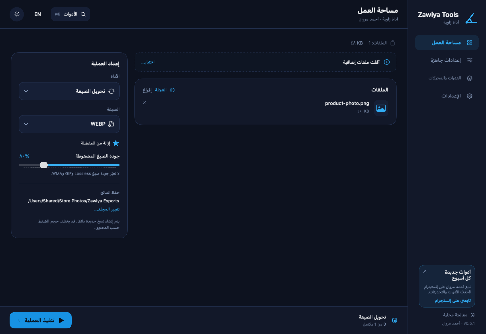

# Zawiya Tools (أداة زاوية)

**Convert, compress and clean your files on your own computer. Nothing is uploaded anywhere.**
Images · video · audio · PDF · Arabic OCR · subtitles · ZIP

[العربية](README.md) · English

Free and open source (GPL-3.0). Native macOS app (Swift/SwiftUI) and Windows app (Tauri/Rust). Built by [Ahmed Marwan](https://ahmedqa.com).

## Why this exists

Most online converters make you upload private files (IDs, contracts, client media) to a server you know nothing about, and few of them handle Arabic and right-to-left text well. Zawiya Tools does the same jobs offline, with an Arabic-first interface and no account.

## Download

Get the latest build from **[Releases](https://github.com/ahmed1blog-dot/zawiya-tools/releases/latest)**.

| Platform | File | Requirements |
|---|---|---|
| macOS | `Zawiya-Tools-x.y.z-Mac.zip` | Apple Silicon (M1 or later), macOS 14+ |
| Windows | `Zawiya.Tools_x.y.z_x64-setup.exe` | Windows 10 or 11, 64-bit |

**macOS:** move the app to *Applications*, open it once, then allow it in *System Settings → Privacy & Security → Open Anyway*. The app is not notarized because it is free and not enrolled in Apple's paid program.
**Windows:** if SmartScreen appears, choose *More info → Run anyway*. The installer is per-user and needs no admin rights.

Updates install automatically and are signed (EdDSA on macOS, minisign on Windows). The app rejects any update that is not signed with the developer's key.

## What it does

| Area | Tools |
|---|---|
| Images | Convert between JPG / PNG / WebP / HEIC / TIFF / BMP / PDF, resize, quality control, metadata removal |
| Video | MP4 / MOV / MKV / WebM / AVI / GIF, compress, trim, extract audio, PNG still |
| Audio | MP3 / M4A / WAV / FLAC / OGG / Opus / AIFF / WMA, compress and trim |
| PDF | Merge, split, images to PDF, pages to images, text extraction, OCR for scanned pages |
| Subtitles | SRT / VTT / TXT, keeping Arabic text and timing intact |
| Archives | Create ZIP files from files and folders |
| OCR | macOS: Arabic and English built in. Windows: uses the OCR languages installed in Windows (add the Arabic language pack in Settings) |
| Quick wheel | Drag a file to open the convert/tools wheel. macOS: hold ⇧, ⌘ or ⌃ while dragging from Finder. Windows: select files in Explorer and press Ctrl+Alt+Z, drop them on the floating bubble, or right-click → "أداة زاوية…" |

## Privacy and safety

- All processing happens on your device. Your files and their names are never uploaded.
- Originals are never overwritten. Results are new copies in a **Zawiya Exports** folder next to the source file.
- The only network use is checking for updates and fetching the announcement card from this repository. No identifier or data about you is sent.
- Details of the safety model (engines run without a shell, restricted FFmpeg protocols, size limits, atomic writes) are in [mac/SECURITY.md](mac/SECURITY.md).

## Build from source

| Platform | Guide |
|---|---|
| macOS (Swift Package) | [mac/README.md](mac/README.md) |
| Windows (Tauri 2 + Rust) | [CONTRIBUTING.md](CONTRIBUTING.md#windows) |

## Contributing

Contributions are welcome, especially Arabic/RTL fixes, tests and Windows polish. Start with [CONTRIBUTING.md](CONTRIBUTING.md) and look for issues labelled **good first issue**.

## License

© 2026 Ahmed Marwan. Licensed under **GNU GPL v3.0**: you may use, modify and redistribute it, as long as you keep the author's name and this notice and publish modified versions under the same license. See [LICENSE](LICENSE) and [THIRD-PARTY-NOTICES.md](THIRD-PARTY-NOTICES.md).
