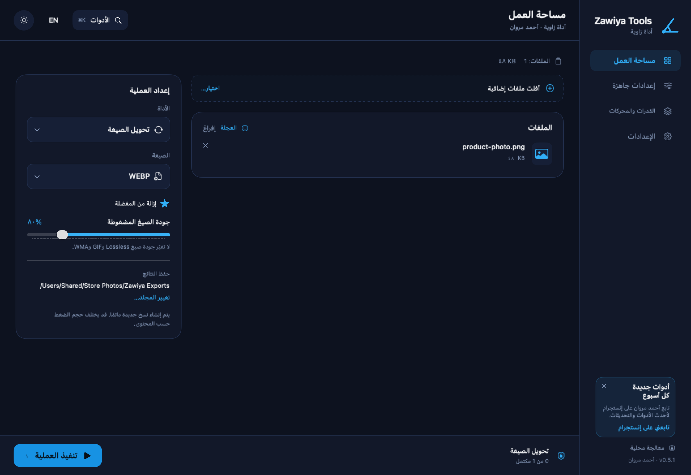
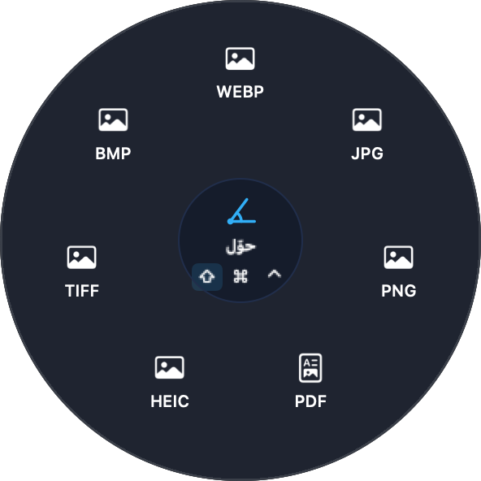
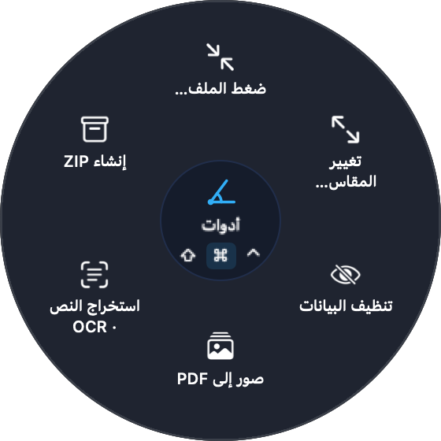

# Zawiya Tools · أداة زاوية

**حوّل وضغط ونظّف ملفاتك على جهازك بدون رفعها لأي موقع**
صور · فيديو · صوت · PDF · OCR عربي · ترجمة · ZIP

تطوير **[أحمد مروان](https://ahmedqa.com)** · إنستجرام **[@qqad7](https://instagram.com/qqad7)** · مفتوح المصدر برخصة **GPL-3.0**

  

## التنزيل

ادخل صفحة **[آخر إصدار](https://github.com/ahmed1blog-dot/zawiya-tools/releases/latest)** ونزّل الملف المناسب:

| الجهاز | الملف | المتطلبات |
|---|---|---|
| **Mac** | `Zawiya-Tools-x.y.z-Mac.zip` | Apple Silicon (M1 وما بعده)، macOS 14 أو أحدث |
| **Windows** | `Zawiya.Tools_x.y.z_x64-setup.exe` | Windows 10 أو 11، 64-bit |

### التثبيت على Mac

1. افتح ملف الـ zip، واسحب **Zawiya Tools** إلى مجلد **Applications** (التطبيقات). مهم: لا تشغله من مجلد التنزيلات.
2. افتح التطبيق. سيظهر تنبيه أن المطوّر غير موثّق لدى Apple، اضغط **Done/تم**.
3. افتح **System Settings ← Privacy & Security**، وانزل إلى الأسفل واضغط **Open Anyway** ثم أكّد.
4. يفتح التطبيق، ولن يظهر التنبيه مرة أخرى. التحديثات القادمة تثبت تلقائياً.

> التنبيه يظهر لأن التطبيق مجاني وغير مسجل في برنامج Apple المدفوع، وليس لوجود مشكلة. الكود كله مفتوح هنا للمراجعة.

### التثبيت على Windows

1. شغّل ملف `setup.exe`.
2. إذا ظهرت رسالة **Windows protected your PC**، اضغط **More info** ثم **Run anyway**.
3. التثبيت للمستخدم الحالي فقط ولا يحتاج صلاحيات مدير. التحديثات القادمة تثبت تلقائياً.

## ماذا يفعل؟

| المجال | الأدوات |
|---|---|
| الصور | JPG / PNG / WebP / HEIC / TIFF / BMP / PDF، تصغير المقاس، ضبط الجودة، حذف البيانات الوصفية (Metadata) |
| الفيديو | MP4 / MOV / MKV / WebM / AVI / GIF، ضغط، قص، استخراج الصوت، لقطة PNG |
| الصوت | MP3 / M4A / WAV / FLAC / OGG / Opus / AIFF / WMA، ضغط وقص |
| PDF | دمج، تقسيم، صور إلى PDF، صفحات إلى صور، استخراج النص، OCR للصفحات المصورة |
| الترجمة | SRT / VTT / TXT مع الحفاظ على العربية والتوقيت |
| الأرشيف | إنشاء ZIP للملفات والمجلدات |
| OCR | Mac: عربي وإنجليزي مدمج. Windows: يستخدم لغات OCR المثبتة في Windows؛ للعربية أضف حزمة اللغة العربية من الإعدادات |
| العجلة السريعة | عجلة التحويل والأدوات والإجراءات. Mac: اضغط ⇧ أو ⌘ أو ⌃ أثناء سحب الملف من Finder. Windows: حدد ملفات في المستكشف واضغط Ctrl+Alt+Z، أو أفلتها على الفقاعة العائمة، أو انقر بالزر الأيمن ← «أداة زاوية…» |

## الخصوصية والأمان

- كل المعالجة على جهازك. ملفاتك وأسماؤها لا تُرفع لأي خادم.
- الأصل لا يُستبدل أبداً. النتائج نسخ جديدة داخل مجلد **Zawiya Exports** بجوار الملف.
- الاتصال الوحيد بالإنترنت: التحقق من التحديثات، وجلب بطاقة الإعلانات من هذا المستودع. لا يُرسل أي معرّف أو بيانات عنك.
- التحديثات موقعة رقمياً (EdDSA على Mac وminisign على Windows) ويرفض التطبيق أي تحديث غير موقع بمفتاح المطوّر.

## للمطورين

- كود Mac (Swift/SwiftUI): [`mac/`](mac/README.md)
- كود Windows (Tauri/Rust): [`windows/`](windows/)
- بطاقة الإعلان داخل التطبيق: [`announcements/`](announcements/README.md)

---

## English

**Zawiya Tools** converts, compresses and cleans images, video, audio, PDFs and subtitles **locally** — nothing is uploaded. Native macOS app (Swift) and a Windows app (Tauri). Auto-updates from GitHub Releases, signed updates only.

Download from **[Releases](https://github.com/ahmed1blog-dot/zawiya-tools/releases/latest)**. On macOS move the app to Applications, then allow it once in *System Settings → Privacy & Security → Open Anyway* (the app is not notarized). On Windows choose *More info → Run anyway* if SmartScreen appears.

## الحقوق والرخصة · License

© 2026 **أحمد مروان (Ahmed Marwan)** — [ahmedqa.com](https://ahmedqa.com) · [@qqad7](https://instagram.com/qqad7)

مرخّص بموجب **GNU GPL v3.0**: يحق لك الاستخدام والتعديل وإعادة النشر، بشرط الإبقاء على اسم المطوّر وهذه الحقوق، ونشر أي نسخة معدلة بنفس الرخصة ومفتوحة المصدر. انظر [LICENSE](LICENSE) و[THIRD-PARTY-NOTICES.md](THIRD-PARTY-NOTICES.md).

Licensed under the GNU General Public License v3.0. Modified versions must keep the author's copyright notice and remain open source under the same license.
